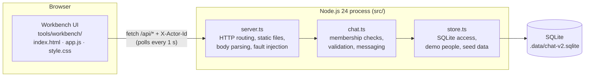
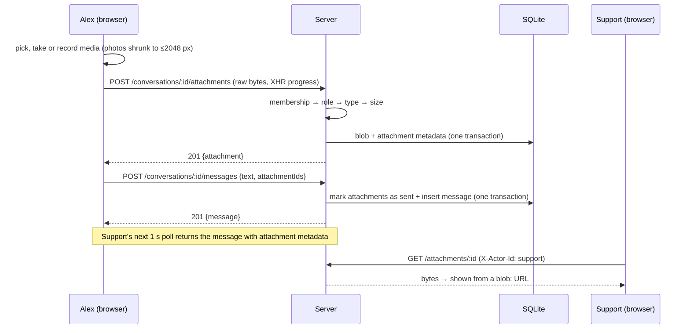
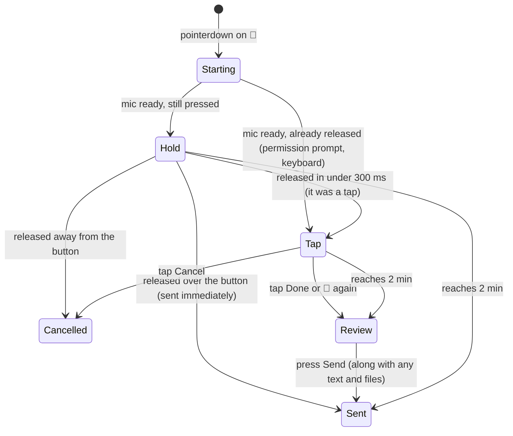

# Nearby Chat — System Design

This document has two parts:

1. **[Current system](#part-1--current-system)**: how the Nearby Chat starter works: architecture, data, API and frontend.
2. **[Improvement: rich media messaging](#part-2--improvement-rich-media-messaging)**: the requirements for scenario S1 (*Help Alex explain the problem*) and the design that implements them.

---

## Part 1 — Current system

### 1.1 Purpose

Nearby Chat is a local demo of a home-services messaging product. Alex (customer) has a leaking kitchen sink. Jordan and Sam are plumbers (professionals). Nearby Support is the platform's customer service team. One browser page can switch between these people to simulate each side of a conversation.

### 1.2 Architecture



- **Single process, no framework.** `node:http` for the server, `node:sqlite` (`DatabaseSync`) for storage, run through `tsx`. No dependencies beyond TypeScript tooling.
- **Static UI.** Plain HTML/CSS/ES modules served by the same server (`/`, `/app.js`, `/style.css`) with `Cache-Control: no-store`.
- **Configuration:** `PORT` (default 4310) and `CHAT_DB` (default `.data/chat-v2.sqlite`).

### 1.3 Identity and access

- There are four hard-coded people in `store.ts`: `customer` (Alex), `pro-1` (Jordan), `pro-2` (Sam) and `support` (Nearby Support). Each has a `role` of `customer`, `professional` or `support`.
- Every `/api/*` request names its identity in the `X-Actor-Id` header. An unknown identity gets **401**. This simulates who is signed in; it is not real authentication.
- **Membership is the access rule.** A conversation is visible only to its `participantIds`. Any other identity gets **404**, so it can't tell whether the conversation exists. The server sets the message sender from the identity, never from the request body.

### 1.4 Data model

| Type | Fields |
| --- | --- |
| `Person` | `id, name, role, description` (static, in code) |
| `Conversation` | `id, participantIds[], createdAt` |
| `Message` | `id, conversationId, senderId, text, createdAt` |
| `Fault` | `"none" \| "before-save" \| "after-save"` (in memory only) |

**Storage.** One generic table holds every record as JSON:

```sql
CREATE TABLE records (kind TEXT, id TEXT, data TEXT, PRIMARY KEY(kind, id));
```

- `kind` is `meta`, `conversation` or `message`.
- Messages are read oldest first, ordered by `rowid`.
- The database runs in WAL mode.
- `Store.transaction()` wraps work in `BEGIN IMMEDIATE … COMMIT/ROLLBACK`.
- **Seed and reset:** the first start, and every reset, creates one empty conversation, `support-thread`, between `customer` and `support`. Professionals start with no conversations.

### 1.5 API

| Method / route | Request → response |
| --- | --- |
| `GET /health` | `{ok:true, exercise:"chat-v2"}` |
| `GET /api/state` | `{person, people, conversations}`: only the identity's own conversations |
| `GET /api/conversations/:id/messages` | `{messages}`, oldest first |
| `POST /api/conversations/:id/messages` | `{text}` → `{message}` (201). Text is trimmed and must be 1–4,000 characters |
| `POST /api/dev/fault` | `{mode}`: sets a one-time fault for this identity's next send |
| `POST /api/dev/reset` | Clears all data and faults |

- **Errors** are JSON `{error}` with status 400, 401, 404, 413 or 503. Unexpected errors return 500 and are logged.
- **Request bodies** are read as text, capped at 8 MiB and parsed as JSON objects.

### 1.6 Failure simulation

`/api/dev/fault` sets a one-time fault for the current identity's next message send:

- `before-save`: responds 503 and the message is **not** stored.
- `after-save`: the message **is** stored, but the response is still 503, so the sender doesn't get confirmation.

There is no retry and no duplicate detection. These faults are the basis of scenario S3.

### 1.7 Frontend

- **Identity switcher.** Customer, Professional (a Jordan/Sam dropdown) and Platform. Switching identity resets all view state.
- **Polling.** Every second, `refresh()` fetches `/api/state` and then the open conversation's messages. Two guards keep stale data off the screen:
  - A `revision` counter drops responses from an earlier identity or conversation.
  - A JSON comparison skips re-rendering when nothing changed.
- **Composer.** A textarea; Enter sends and Shift+Enter adds a new line. If a send fails, the text stays in the box and an error is shown.
- **Languages.** English and 中文 strings live in a `dictionary` and are applied through `data-t` attributes. The choice is saved in `localStorage`.
- **Security.** All dynamic text goes through `esc()` before it is added as HTML.

---

## Part 2 — Improvement: rich media messaging

### 2.1 Problem

Alex has to describe a leaking sink in words, which leads to a lot of back-and-forth: *Where exactly? How fast is it dripping? Is there water damage?* A photo, a short video or a quick voice note answers most of these questions in one message. Support and providers also need a faster way to reply than typing.

### 2.2 Requirements

| # | Requirement |
| --- | --- |
| R1 | **Scenario S1:** help Alex describe the leak clearly, without a long back-and-forth. |
| R2 | **Audio (customer):** click **or** hold a button to talk about the issue, then send it to the service provider. |
| R3 | **Image (customer):** upload a photo, **or** open the phone camera to take one, then send it. |
| R4 | **Video (customer):** upload a video, **or** open the phone camera to record one, then send it. |
| R5 | **Audio (service side):** the service side can send voice messages to the customer. Audio only for now. |
| R6 | Keep existing text messaging working. Keep people's data separate. Saved messages must survive a refresh and a restart. |

**Decisions made with the product owner**

- "Service side" for R5 means **Nearby Support**, which can send audio only.
- The **professional role is out of scope** for this change and stays text-only.
- **Size limits:** image **20 MB**, video **100 MB**, audio **30 MB**.
- **Media only.** No guided prompts or forms for describing the problem.
- **Verify on desktop, ready for phones.** Use mobile-native capture inputs with fallbacks. Add a `HOST` option so a phone can reach the server. HTTPS is not part of this change.

### 2.3 Capability matrix

| Role | Text | Voice | Photo | Video |
| --- | :-: | :-: | :-: | :-: |
| Customer (Alex) | ✅ | ✅ | ✅ | ✅ |
| Nearby Support | ✅ | ✅ | ❌ | ❌ |
| Professional (Jordan, Sam) | ✅ | ❌ | ❌ | ❌ |

The **server** enforces this matrix (403). The UI only hides the buttons a role can't use.

### 2.4 Data model changes

```ts
type AttachmentKind = "image" | "audio" | "video";

type Attachment = {
  id: string;
  conversationId: string;   // the conversation it was uploaded to
  uploaderId: string;       // who uploaded it
  kind: AttachmentKind;
  mime: string;             // base type, parameters removed (e.g. "audio/webm")
  size: number;             // bytes
  name?: string;            // original file name
  durationMs?: number;      // voice notes: measured by the browser while recording
  messageId?: string;       // set once it is sent; an attachment is used only once
  createdAt: string;
};

type Message = {
  // ...existing fields
  text: string;               // may be "" when the message has attachments
  attachments?: Attachment[]; // metadata only; file bytes are fetched separately
};
```

**Storage.** Attachment metadata is stored as a `records` row of kind `attachment`. The file bytes go in a new table:

```sql
CREATE TABLE blobs (id TEXT PRIMARY KEY, data BLOB NOT NULL);
```

- Saving a file writes the blob and its metadata in one transaction.
- `reset()` empties both tables.
- Files live in the same SQLite file, so they survive a restart, and `.data/` is already git-ignored.

### 2.5 API changes

| Route | Behavior |
| --- | --- |
| `POST /api/conversations/:id/attachments` | **Raw file body** (not JSON). Takes the `Content-Type`, an optional `X-File-Name` (URI-encoded) and an optional `X-Duration-Ms`. Checks membership, the role's allowed types and the size limit, then returns `{attachment}` (201), not yet attached to a message. |
| `GET /api/attachments/:id` | Returns the file bytes. Only members of the attachment's conversation can read it; anyone else gets 404. Sent with the stored `Content-Type`, `nosniff`, a sandbox CSP and `Cache-Control: private, immutable`. |
| `POST /api/conversations/:id/messages` | Body is now `{text?, attachmentIds?}`. A message needs text or 1–4 attachments. Each attachment must exist, be in this conversation, be uploaded by the sender and not already be sent; otherwise 400. Attaching the files and creating the message happen in one transaction. |

**Validation**

| Kind | Allowed types | Limit |
| --- | --- | --- |
| image | jpeg, png, webp, gif, heic, heif | 20 MiB |
| audio | webm, ogg, mp4 (m4a), mpeg, aac, x-m4a, wav | 30 MiB |
| video | mp4, webm, quicktime | 100 MiB |

- Unknown type → **415**. Role not allowed → **403**. Over the limit → **413**. Empty file → **400**.
- **The upload route checks before reading.** It is matched before the generic JSON body reader, so membership, role and type are checked before any bytes are read.
- **Oversized uploads.** The body is read into a list of buffers. Bytes past the limit are discarded but still read, so the client gets a clean 413 instead of a dropped connection.

**Why two steps (upload, then send)**

- **Progress and retry per file.** Each file shows its own progress bar and can be retried without resending the message.
- **No multipart parsing.** The server needs no multipart parser and no base64 conversion inside JSON.
- **Simple sending.** The send call stays a small JSON request that works the same with or without files.



### 2.6 Frontend design

**Composer toolbar** (shown per role): 🎤 Voice · 📷 Photo ▾ · 🎥 Video ▾. On phone-width screens the buttons show only their icons, and the labels stay readable by screen readers.

**Voice: two ways to record**



- **Recording.** `getUserMedia` plus `MediaRecorder`. The format is the first one the browser supports: `audio/webm;codecs=opus` (Chrome), `audio/mp4` (Safari) or ogg.
- **Duration.** The browser measures the length and sends it in `X-Duration-Ms`, because recorded webm files often don't store their length.
- **Recording bar.** It shows a pulsing dot, a timer and a hint ("Release to send · move away to cancel", which turns red when the clip will be cancelled). The bar is **overlaid** on the text box so it doesn't move the 🎤 button out from under a held finger. This bug was found and fixed during testing.
- **Touch and keyboard.** `touch-action:none` and a suppressed context menu stop long-presses from triggering text selection or menus. Keyboard users press Enter or Space to start a recording, and again to stop and review it.
- **Fallback.** If there is no microphone API (for example a phone over plain `http`) or permission is denied, the app shows a short message and opens `<input type=file accept="audio/*" capture>`, which uses the phone's own recorder.

**Photo and video**

- **"Take photo" / "Record video" on phones** (`pointer: coarse`) use `<input type=file accept="image/*|video/*" capture="environment">`, which opens the native camera. This works even over plain `http`.
- **"Take photo" / "Record video" on desktops** open an in-page camera window (`getUserMedia` and a `<video>` preview). It takes a photo by drawing the frame to a canvas and saving a JPEG, or records video with `MediaRecorder`. If the camera isn't available, it falls back to the file picker.
- **"Upload"** opens the file picker (multiple photos are allowed). Images can also be **pasted** or **dragged** into the composer.
- **Image shrinking.** JPEG, PNG and WebP photos over 1.5 MB are redrawn at no more than 2048 px as JPEG (quality 0.85) before upload. The smaller version is kept only if it is actually smaller. In testing, an 8 MB PNG became a 2048 px JPEG.
- **Early checks in the browser.** The browser checks the type and size limits before uploading, so Alex gets an immediate message. The server checks again.

**Attachment tray** (above the text box)

- Each item shows a thumbnail (or an audio player), its name or "Voice message · 0:12", a status, a progress bar, Retry and ✕.
- Uploads start as soon as a file is added. Send is disabled while uploads are still running.
- If a send fails, the text and the tray are kept.
- Switching identity or conversation cancels uploads, recordings and the camera.

**Message rendering**

| Kind | Shown as |
| --- | --- |
| image | A thumbnail up to 240 px. Clicking it opens a full-size viewer (`<dialog>`). |
| video | `<video controls playsinline preload="metadata">` |
| audio | "🎤 Voice message · m:ss" label above `<audio controls>` |

- **Loading files.** ``, `<video>` and `<audio>` can't send the `X-Actor-Id` header, so files are fetched with `fetch`, turned into `blob:` URLs and cached per attachment. The cache is cleared and the URLs released when the identity changes.
- **Adding messages without rebuilding the list.** The original code rebuilt the whole message list whenever anything changed. That would stop a playing voice note every time the 1 s poll brought a new message. Now new messages are only appended. The list is rebuilt only when the identity, conversation or language changes, or after a reset.
- **Scrolling.** The view stays pinned to the bottom while media loads, if the user was already at the bottom.
- **Avoiding a double send.** With the `after-save` fault, the message is saved but the sender gets an error. When the saved message shows up in the next poll, its files are removed from the tray, so they can't be sent a second time.

**Languages.** Every new label, hint and error has English and 中文 strings in the existing `dictionary`.

### 2.7 Security and privacy

- **Access.** Membership is checked on every file upload and download, and the role matrix is enforced on the server.
- **Data separation.** A person can only send attachments they uploaded to that conversation. Each attachment can be sent only once.
- **Allowed types only.** Uploads must match a list of allowed media types. Files are served with `nosniff` and a `sandbox` CSP, so an uploaded file can't run as a page.
- **HTML escaping.** File names and captions are escaped before display.

### 2.8 Configuration

- `HOST` sets the address the server listens on (default `127.0.0.1`).
- Set `HOST=0.0.0.0` to open the app from a phone on the same Wi-Fi.

### 2.9 Verification

- **`npm run typecheck`.**
- **`npm run check`** (`scripts/check.ts`, `node:test`). It starts the real server on a random port with a temporary database and checks:
  1. Text messaging still works, and empty text is rejected.
  2. A customer sends the sample photo with a caption, and Support downloads identical bytes.
  3. A customer can send video and voice with no text, and the duration is kept.
  4. Support gets 403 for image and video, can send audio, and Alex can play it back.
  5. A non-member gets 404 for files and uploads, and an unknown identity gets 401.
  6. These requests are rejected:
     - unsupported type (415) and empty file (400)
     - files over the 20/30/100 MiB limits (413); files exactly at the limit are accepted
     - an attachment that was already sent, another person's attachment, a missing id or a malformed list (400)
     - more than 4 attachments (400)
  7. Messages and file bytes survive a restart, and reset removes them.
- **Manual testing in the browser pane** (the pane blocks the real mic and camera, so a synthetic audio stream was used):
  - photo upload, shrinking, caption and full-size viewer
  - voice note by tap-and-review and by hold-to-send, and hold-then-slide-away to cancel
  - video upload and playback
  - Support's voice reply
  - a playing voice note keeps playing when a new message arrives
  - Support and Professional see only the right buttons
  - error messages for a PDF and a 21 MB file
  - camera fallback when the camera is blocked
  - `after-save` fault with an attachment
  - the 375 px phone layout has no horizontal scroll

### 2.10 Tradeoffs and known gaps

| Area | Choice now | What production would need |
| --- | --- | --- |
| File storage | BLOBs in SQLite, read fully into memory | Object storage (S3/GCS), signed URLs, range requests for seeking in video |
| Media processing | None: no conversion, no server thumbnails, no virus scan | Convert to common formats (HEIC→JPEG, MOV→MP4), make thumbnails and posters, virus scanning |
| Playback in the browser | Whole file fetched into a `blob:` URL | Streaming with range requests, and cookie or token auth so `<video src>` can work directly |
| Phone capture | Native camera via `capture`; in-page mic needs HTTPS | Serve over HTTPS so in-page recording works on phones |
| Unsent uploads | Kept until Reset demo | A clean-up job that deletes old unsent attachments |
| Retry / duplicate sends | Unchanged; covered by scenario S3 | Request ids to detect duplicate sends |
| Professionals | Text only (out of scope) | Turn on audio for `professional` in the role matrix (a one-line policy change) |

### 2.11 Changed files

| File | Change |
| --- | --- |
| `src/types.ts` | `Attachment`, `AttachmentKind`, `Message.attachments` |
| `src/store.ts` | `blobs` table, `putBlob`/`getBlob`, reset clears blobs |
| `src/chat.ts` | Role matrix, type list and limits, `planUpload`, `saveUpload`, `attachment`, sending with attachments |
| `src/server.ts` | Upload and download routes, upload read as raw bytes, `HOST` |
| `tools/workbench/*` | Toolbar, recorder, camera window, tray, viewer, media rendering, appending new messages, strings |
| `scripts/check.ts`, `package.json`, `tsconfig.json` | End-to-end checks, `npm run check` |
| `CONTRACT.md`, `README.md` | API reference and code map updates |
